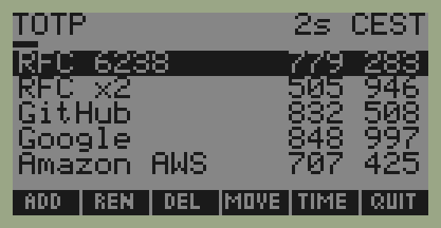
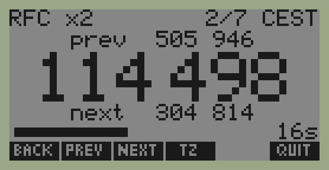

# hp48-totp

An HP 48G (1993, 32 KB RAM, 4-bit Saturn CPU) as an offline two-factor token.
It shows the same 6-digit TOTP codes (RFC 6238, HMAC-SHA1, 30 s) as
Google Authenticator, Ente Auth or Authy, computed from the calculator's own
clock, with no network. It's an air-gapped backup in case the phone is lost.

| Home: every account and its current code | One account: previous, current, next |
|---|---|
|  |  |

*(Screenshots from an emulated 48GX with test accounts.)*

- **Home view:** every account with its current code and a shared countdown.
  ▲▼ select, ENTER (or ▶) opens an account. Soft keys **ADD**, **REN**, **DEL**,
  **MOVE**, **TIME**, **QUIT**.
- **Account view:** the current code in large digits, with the previous and next
  ones, in case the clock has drifted. **BACK** (or ◀), **PREV** / **NEXT**
  (or ▲▼), **TZ** (CET ↔ CEST), **QUIT**.
- **Accounts are added on the calculator itself:** ADD asks for a name and the
  base32 secret, then computes everything on the 48. No PC needed after install.
- **Auto power-off:** after 3 minutes without a key press the calculator turns
  off; ON brings the app back.

How it works in depth (algorithm, Saturn code, object layouts, cable, pitfalls):
[DESIGN.md](DESIGN.md).

## How it works

- **HMAC midstates.** HMAC-SHA1 hashes the key, padded to one 64-byte block and
  XORed with ipad or opad, and that first compression never changes. It's done
  once, when the account is added; only those two SHA-1 states (the
  *midstates*) are stored. Each code then needs **2 compressions** instead of 4.
  The midstates are as sensitive as the secret itself.
- **SHA-1 in Saturn assembly** (`asm/sha1.a`):
  - XOR is built from AND, OR and NOT, which the Saturn lacks as one instruction.
  - Rotations combine nibble shifts and bit shifts.
  - Arithmetic is 32-bit in field WP with P=7.
  - Words are stored least significant nibble first, the Saturn's own order, so
    loads and stores never swap bytes.
  - One compression is about 8,800 instructions.
- **Two Code objects**, pure machine code with no ROM calls:
  - `HOTP` (`asm/hotp.a`): both HMAC blocks, the two compressions and the
    dynamic truncation. About 0.05 s per code at 48G speed.
  - `SHAC` (`asm/shac.a`): one compression on a state list, used to compute the
    midstates when you add an account.
- **The app's main program in System RPL** (`srpl/otp.s`): the 48's internal
  language, without argument checks and with small binary integers instead of
  reals. It's about twice as fast as the User RPL version it replaced (▲▼ in
  0.18 s, opening an account in 0.5 s) and allocates much less, which matters
  more: see below.
- **Helpers in User RPL** (`rpl/`): adding, renaming, deleting accounts, the
  clock form, base32 and midstates, and small wrappers for commands System RPL
  has no supported entry for (`WAIT`, `OFF`, `TIME`).
- **The app as a whole:**
  - The clock is turned into Unix time with `TZ` as the UTC offset.
  - The screen is drawn into PICT and shown full screen with `PVIEW`, so the
    bottom row can hold the app's own key labels.
  - Built for a 48G's 32 KB: the loop allocates so little that garbage
    collection, which freezes the 48 for seconds, rarely kicks in. The clock
    is read once per window, the next window's codes are computed ahead, and
    screens are drawn straight into display memory. Details in
    [DESIGN.md](DESIGN.md#garbage-collection).

## Install

You need an HP 48G or 48GX and a serial cable to the PC through a USB-RS232
adapter (real RS-232 levels; pinout in [DESIGN.md](DESIGN.md#cable)). On the
calculator: wire mode (`-33 CF`) and `IOPAR` set to `{ 9600 0 0 0 3 1 }`.

**Back up your calculator first.** This is machine code, and a bug can clear
the memory.

The whole app is one file, [`dist/TOTP`](dist/TOTP), about 10 KB:

1. On the 48, in `HOME`, start the Kermit server (`SERVER`).
2. Send `dist/TOTP` with any Kermit program, in binary mode. With the one in
   this repository:
   ```sh
   python3 tools/hpkermit.py /dev/serial/by-id/usb-... send dist/TOTP TOTP
   python3 tools/hpkermit.py /dev/serial/by-id/usb-... finish
   ```
   (`ls /dev/serial/by-id/` shows your adapter.)
3. On the 48: **VAR**, **TOTP**, then **OTP**.
4. In the app: **TIME** to set the clock (local time, to the second if you can;
   `TZ` is the UTC offset in hours), then **ADD** for each account.

Check a code against your phone before relying on it.

## Accounts

- **On the calculator:** ADD asks for a name (12 characters at most) and the
  base32 secret, which services show under "can't scan the QR code?". Spaces,
  dashes and lower case are fine. Computing the midstates takes a few seconds,
  then the new account opens so you can compare its code.
- **REN** renames, **DEL** deletes (after confirmation), **MOVE** then ▲▼
  reorders (ENTER when done).
- **From the PC, many at once:** `ref/make_hp_payload.py --import FILE` reads
  `otpauth://` URIs, one per line (Ente Auth: ☰ → Data → Export codes →
  Plain text; Aegis also works).
  - It skips what the 48 can't do (SHA-256/512, 8 digits, 60 s periods, HOTP)
    and says why.
  - It asks which accounts to keep and a short name for each.
  - It writes `out/ACCTS`, mode 0600 and ignored by git.

  Inside `TOTP` on the 48, run `'ACCTS' PURGE` (this replaces all accounts),
  start `SERVER` and send `out/ACCTS`. **Delete the export afterwards:**
  `shred -u FILE`. With no option, the script prompts for accounts one by one,
  without echoing the secret.
- **Authy can't export its secrets.** For each service, re-enroll 2FA and copy
  the base32 secret into both Authy and the 48.

## Memory

| Part | Size |
|---|---|
| The app | about 10 KB |
| Each account | about 200 B |
| At run time | about 2 KB more (scratch string, temporaries) |

With a handful of accounts, keep about 15 KB free; more free memory means fewer
pauses for garbage collection.

## Security

- The calculator has no protection: anyone holding it can read `ACCTS`. Treat it
  like a key.
- Never paste a secret into a chat or a command line. Use ADD on the 48, or the
  script's prompts, which don't echo. If a secret has leaked, re-enroll that
  service.
- `out/` is git-ignored. The tests only use RFC and made-up test secrets.

## Troubleshooting

- **Codes off by one window:** the 48's clock has drifted. The previous or next
  code in the account view usually matches; set the time again with **TIME**.
- **"Bad base32 character":** the secret contains something other than A–Z,
  2–7, spaces, dashes or `=`.
- **"WRK is not a string" / "WRK too short":** `WRK` is the scratch string the
  machine code writes into. Run `'WRK' PURGE`; the app recreates it.
- **Kermit gets no answer:** check that the 48 shows "Awaiting Server Cmd." and
  is in wire mode (`-33 CF`).
- **The 48 restarts, or VAR crashes inside `TOTP`:** memory is corrupted. Delete
  the directory with `'TOTP' PGDIR` (as a last resort, ON+A+F wipes everything)
  and reinstall.

## Development

### Make targets

`make` alone lists the main ones.

| Target | What it does |
|---|---|
| `make toolchain` | Build HP Tools and x48ng and fetch the ROM (`scripts/setup-toolchain.sh`, safe to re-run) |
| `make check` | `make test` + `make asm-test` + `make srpl`, what CI runs |
| `make test` | Python reference: SHA-1, HOTP/TOTP via HMAC and via midstates, payload format, otpauth import |
| `make trace` | SHA-1 state after every round for the RFC vector (the reference for the asm) |
| `make asm` | Assemble `asm/*.a` with HP Tools into `asm/*.bin` (HPHP48 binary objects) |
| `make srpl` | Compile `srpl/otp.s` (System RPL) with `rplcomp`, link it against the ROM entry points |
| `make asm-test` | Run the asm routines on x48ng's CPU core (`tools/satrun`), with no ROM or UI |
| `make app` | Build `out/TOTP`: the app directory (RPL programs + big digit font) as text |
| `make dist` | Build `dist/TOTP`: the app with its machine code, as one binary directory, by installing it on the emulator and fetching it back |
| `make payload-rfc` | `out/ACCTS` with RFC test accounts |
| `make e2e` | Boot headless 48GXs in x48ng: HOTP, app programs, rendered screen, a live session driven by keys, and the one-file install (~8 min) |
| `make emu` | Emu48 under Wine, for poking around by hand |

### Test layers

1. **`make test`**: the Python reference (`ref/`) checked against the RFC 4226
   and RFC 6238 vectors, both through `hmac` and through the 2-compression
   midstate path the calculator uses.
2. **`make asm-test`**: `tools/satrun` is x48ng's Saturn core with flat memory,
   driven by `asm/saturn.py`. You load a routine, set registers and memory
   (including a fake RPL stack), run it and read the results back. Breakpoints
   print registers, which is how every one of the 80 SHA-1 rounds is compared
   with `ref/sha1_trace.py`. HOTP is checked on the RFC counters, on random keys
   (including keys over 64 bytes) and on 64-bit counters, and SHAC on random
   compressions and the RFC midstates, along with the restored RPL registers.
3. **`make e2e`**: `tools/hp48.py` runs x48ng in tmux (`tools/x48.sh`), types on
   the keyboard, and moves objects with `tools/hpkermit.py`. `hp.eval("…")` runs
   RPL on the calculator and `hp.result()` returns level 1.
   - `tests/test_app.py` checks the programs (including base32 decoding and
     midstates computed on the calculator) and the rendered screen pixel by
     pixel.
   - It then runs one live session: home view, opening an account, PREV, TZ,
     ADD with a secret typed on the keyboard, MOVE and DEL. Each step is read
     back from the emulator's display: `tools/hpgrob.py` decodes the TUI's
     quadrant characters into pixels, and the home rows use the calculator's
     own medium-font glyphs.
   - `tests/test_dist.py` installs `dist/TOTP` alone on a fresh 48GX and adds an
     account.
4. **The real calculator**: `tools/hpkermit.py PORT send|get|finish`. Reading
   variables back with `get` is the way to verify an install.

### Repository layout

| Path | Contents |
|---|---|
| `ref/` | Python reference, SHA-1 tracer, payload/ACCTS generator, their tests |
| `asm/` | Saturn sources (`sha1.a`, `hotp.a`, `hello.a`), SLOAD control files, asm tests |
| `srpl/` | `otp.s`: the app's main program in System RPL |
| `rpl/` | User RPL helpers, one object per file, in `%%HP` text with `\<<` trigraphs |
| `tests/` | End-to-end tests on the emulator |
| `tools/` | satrun, Kermit client, x48ng driver, GROB/screen codec, app builder, Emu48 launcher |
| `dist/` | `TOTP`: the release, one binary directory object |
| `docs/` | Screenshots |

RPL variable names must not collide with built-in commands: `DRAW` and `MENU`
did, and fail with "Invalid Syntax" inside a directory.

### Calling the machine code directly

- `keys counter R→B WRK HOTP B→R 1000000 MOD`: `keys` is a list of 10 binary
  integers (istate then ostate, `ACCTS i GET 2 GET`), and `WRK` a string of at
  least 355 characters. `HOTP` overwrites the counter object with the result, so
  it must be a fresh object, straight from `R→B`.
- `state block WRK SHAC`: `state` is a fresh list of 5 binary integers, updated
  in place, and `block` a 64-character string whose 4-byte words are byte-reversed
  (see `PADB`). `"secret" B32D MIDS` gives the 10-word list for `ACCTS`.

### Local toolchain (not in the repo)

`scripts/setup-toolchain.sh` puts everything in `$HP48_EMU_HOME`
(default `~/.local/share/hp48-emu/`):

- **`hptools/entries/`:** the supported ROM entry points (`SupRomEntr.a` from
  the GNU Tools for HP48), assembled into `entries.o` for linking System RPL.
- **`hptools/bin/`:** HP Tools 3.0.8 (`sasm`, `sload`, `rplcomp`).
  - Built from the hpcalc.org source with Jonathan Busby's 0.3.2.1 Linux patch
    (`patch -p2`) and `CFLAGS="-O2 -std=gnu89 -fcommon -w"`.
- **`src/x48ng/`:** x48ng 1.3.1 from codeberg.org/gwh/x48ng (`git clone --recursive`).
  - Build with `make WITH_SDL=no SDL_SRC=src/sdl_bitmaps.c`: upstream's no-SDL
    build misses the key bitmaps.
  - Needs `lua-devel readline-devel ncurses-devel gtk4-devel`.
  - Its `-t` flag enables IR and crashes; `--serial=pty` is what opens the wire port.
- **`x48ng-data/`:** the ROM (`gxrom-r` from hpcalc.org) and the config for x48ng.
  `tools/hp48.py` copies them into a temporary directory for each run.
- **`wine/`** (optional, installed by hand): Emu48 1.68 in its own Wine prefix,
  with the same ROM as `ROM.48G`. Only `make emu` uses it.

The ROM comes from hpcalc.org, which distributes HP 48 ROMs for use in emulators
with HP's permission. It isn't part of this repository.

### x48ng quirks handled by `tools/x48.sh` and `tools/hp48.py`

- **Kermit:** C-Kermit gets no replies through x48ng's pty while raw termios
  works, hence `tools/hpkermit.py`.
- **Dark boots:** cold boots sometimes stay dark (the stuck-on-OFF bug), so the
  script restarts until the screen shows. `--inhibit-shutdown` would avoid this
  but makes the clock drift.
- **Fast clock:** unthrottled emulation runs the calculator's clock fast while
  it's busy, hence `--throttle`. The live test still reads the calculator's time
  off the countdown bar rather than trusting the clock.
- **Dropped keys:** the throttled 48 drops keys typed too fast, so keys are sent
  0.6 s apart.
- **Stalled serial port:** the wire port sometimes stops answering after a
  transfer. The driver presses ON, runs `SERVER` again and retries.
- **Overwriting variables:** flag −36 is set so received files overwrite
  existing variables.
- **Parallel runs:** each run gets its own tmux session and data directory, so
  parallel runs don't collide.
- **Screen capture:** the emulator runs with a terminal type that has no
  hardware tabs. Otherwise tmux would capture the tabs ncurses moves the cursor
  with, and the cells they skip would be lost.

## Contributing

Issues and pull requests are welcome. `make check` must pass; it runs in CI on
every push. For anything that touches the calculator side, also run `make e2e`
locally.

## License

[MIT](LICENSE). The HP 48 ROM, HP Tools and x48ng are not included and keep
their own licenses.
