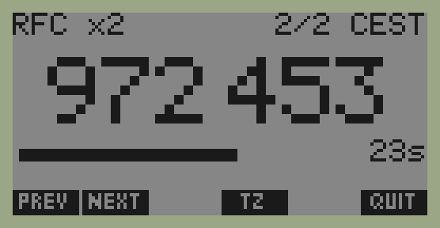

# hp48-totp

An HP 48G (1993, 32 KB RAM, 4-bit Saturn CPU) as an offline two-factor token.
It shows the same 6-digit TOTP codes (RFC 6238, HMAC-SHA1, 30 s) as
Google Authenticator, Ente Auth or Authy, computed from the calculator's own
clock, with no network. It's an air-gapped backup in case the phone is lost.



One screen per account: the name, the account number and time zone, the code in
large digits, and a countdown bar with the seconds left. The soft keys are
**PREV** / **NEXT** (◀ ▶ also work), **TZ** (CET ↔ CEST) and **QUIT** (ON also
quits).

How it works in depth (algorithm, Saturn code, object layouts, cable, pitfalls): [DESIGN.md](DESIGN.md).

## How it works

- **The secret never reaches the calculator.** HMAC-SHA1 hashes the key padded
  to one 64-byte block, XORed with ipad or opad, and that first compression
  never changes. `ref/make_hp_payload.py` computes those two SHA-1 states once
  on the PC (the *midstates*) and only they are sent. They are as sensitive as
  the secret itself, but the calculator then needs **2 compressions per code**
  instead of 4.
- **SHA-1 in Saturn assembly** (`asm/sha1.a`):
  - XOR is built from AND, OR and NOT, which the Saturn lacks as one instruction.
  - Rotations combine nibble shifts and bit shifts.
  - Arithmetic is 32-bit in field WP with P=7.
  - Words are stored least significant nibble first, the Saturn's own order, so
    loads and stores never swap bytes.
  - One compression is about 8,800 instructions.
- **HOTP as a Code object** (`asm/hotp.a`): it builds both HMAC blocks, runs the
  two compressions and does the dynamic truncation. It is pure machine code with
  no ROM calls: it saves the RPL registers in its scratch string and only writes
  into objects it was given. One code takes about 0.05 s at 48G speed.
- **The app in User RPL** (`rpl/`):
  - The clock is turned into Unix time with `TZ` as the UTC offset.
  - The screen is drawn into PICT and shown full screen with `PVIEW`, so the
    bottom row can hold the app's own key labels.
  - The full screen (about 1 s) is redrawn only when the code, the account or
    `TZ` changes.
  - Each second, only the countdown is redrawn, in a single `REPL` (about 0.06 s).

## Using it

### What you need

- An HP 48G or 48GX, and a serial cable to the PC through a USB-RS232 adapter
  (real RS-232 levels; pinout in [DESIGN.md](DESIGN.md#cable)).
- On the calculator, wire mode (`-33 CF`) and `IOPAR` set to `{ 9600 0 0 0 3 1 }`.
- The calculator's clock set to local time, to the second if possible. `TZ`
  (default 2, CEST) is the UTC offset in hours, and the TZ key toggles 1 ↔ 2.

### Install

```sh
make asm app                                   # build HOTP and the TOTP directory
python3 ref/make_hp_payload.py --import FILE   # or with no option, to type accounts in
PORT=/dev/serial/by-id/usb-...
```

1. On the 48: go to `HOME`, then run `SERVER`. Then:
   `python3 tools/hpkermit.py $PORT send out/TOTP TOTP`
2. On the 48: press ON, type `TOTP` (to enter the directory), then run `SERVER`. Then:
   ```sh
   python3 tools/hpkermit.py $PORT send asm/hotp.bin HOTP
   python3 tools/hpkermit.py $PORT send out/ACCTS ACCTS
   python3 tools/hpkermit.py $PORT finish
   ```
3. On the 48: press **OTP**. The first run creates `WRK` (scratch memory) and
   moves `OTP` to the first soft key.

Check a code against your phone before relying on it.

### Accounts

`out/ACCTS` holds `{ { "name" { 10 binary integers } } … }`: each account's
name and its two midstates. It is written with mode 0600 and ignored by git.

- **From an authenticator export:** `--import FILE` reads `otpauth://` URIs,
  one per line (Ente Auth: ☰ → Data → Export codes → Plain text; Aegis also
  works). It skips what the 48 can't do (SHA-256/512, 8 digits, 60 s periods,
  HOTP) and says why, asks which accounts to keep, and asks for a short name for
  each (12 characters at most, to fit the header). **Delete the export
  afterwards:** `shred -u FILE`.
- **By hand:** with no option, the script asks for a name, then a base32 secret
  (the input is hidden). It prints the current code so you can compare.
- **Authy can't export its secrets.** For each service, re-enroll 2FA and use
  "can't scan the QR code?" to get the base32 secret.
- **To replace the accounts on the calculator:** inside `TOTP`, run
  `'ACCTS' PURGE` then `SERVER`, then send `out/ACCTS` again. The 48 doesn't
  overwrite an existing variable on receive unless flag −36 is set. Nothing else
  needs rebuilding.

### Memory

About 4.1 KB stored (TOTP directory 2.9 KB, HOTP 0.8 KB, WRK and PICT), plus
about 200 B per account, plus about 3 KB of headroom while running. On a 48G,
plan for 7–8 KB with a handful of accounts.

### Security

- The calculator has no protection: anyone holding it can read `ACCTS`. Treat it
  like a key.
- Never paste a secret into a chat or a command line; use the prompts, which
  don't echo. If a secret has leaked, re-enroll that service.
- `out/` is git-ignored. The tests only use the RFC test secret.

### Troubleshooting

- **Codes off by one window:** the 48's clock has drifted; set it again. Most
  services accept ±30 s.
- **"WRK missing" / "WRK too short":** `CODE` refuses to run `HOTP` without a
  proper scratch string, since HOTP writes into it in place. `OTP` creates `WRK`
  by itself; you can also `'WRK' PURGE` and run `OTP` again.
- **Kermit gets no answer:** check that the 48 shows "Awaiting Server Cmd." and
  is in wire mode (`-33 CF`).
- **The 48 restarts, or VAR crashes inside `TOTP`:** memory is corrupted. Delete
  the directory with `'TOTP' PGDIR` (or, as a last resort, ON+A+F, which wipes
  everything) and reinstall. This happened once during development, before the
  Kermit client fixes and the WRK check. Since then, a full read-back of the
  directory after a real `OTP` run comes out clean.

## Development

### Make targets

| Target | What it does |
|---|---|
| `make test` | Python reference: SHA-1, HOTP/TOTP via HMAC and via midstates, payload format, otpauth import |
| `make trace` | SHA-1 state after every round for the RFC vector (the reference for the asm) |
| `make asm` | Assemble `asm/*.a` with HP Tools into `asm/*.bin` (HPHP48 binary objects) |
| `make asm-test` | Run the asm routines on x48ng's CPU core (`tools/satrun`), with no ROM or UI |
| `make app` | Build `out/TOTP`: the app directory (RPL programs + big digit font) as text |
| `make payload-rfc` | `out/ACCTS` with RFC test accounts |
| `make e2e` | Boot headless 48GXs in x48ng: HOTP, app programs, rendered screen, and the live app driven by keys (~3.5 min) |
| `make emu` | Emu48 under Wine, for poking around by hand |

### Test layers

1. **`make test`**: the Python reference (`ref/`) checked against the RFC 4226
   and RFC 6238 vectors, both through `hmac` and through the 2-compression
   midstate path the calculator uses.
2. **`make asm-test`**: `tools/satrun` is x48ng's Saturn core with flat memory,
   driven by `asm/saturn.py`. You load a routine, set registers and memory
   (including a fake RPL stack), run it and read the results back. Breakpoints
   print registers, which is how every one of the 80 SHA-1 rounds is compared
   with `ref/sha1_trace.py`. HOTP is checked on the RFC counters, on random keys
   (including keys over 64 bytes) and on 64-bit counters, along with the
   restored RPL registers.
3. **`make e2e`**: `tools/hp48.py` runs x48ng in tmux (`tools/x48.sh`), types on
   the keyboard, and moves objects with `tools/hpkermit.py`. `hp.eval("…")` runs
   RPL on the calculator and `hp.result()` returns level 1. `tests/test_app.py`:
   - checks the programs, and the rendered screen pixel by pixel;
   - runs the live app, reading the code back from the emulator's display
     (`tools/hpgrob.py` decodes the TUI's quadrant characters into pixels);
   - presses NEXT, ◀ and TZ along the way.
4. **The real calculator**: `tools/hpkermit.py PORT send|get|finish`. Reading
   variables back with `get` is the way to verify an install.

### Repository layout

| Path | Contents |
|---|---|
| `ref/` | Python reference, SHA-1 tracer, payload/ACCTS generator, their tests |
| `asm/` | Saturn sources (`sha1.a`, `hotp.a`, `hello.a`), SLOAD control files, asm tests |
| `rpl/` | App programs, one object per file, in `%%HP` text with `\<<` trigraphs |
| `tests/` | End-to-end tests on the emulator |
| `tools/` | satrun, Kermit client, x48ng driver, GROB/screen codec, app builder, Emu48 launcher |
| `docs/` | Screenshot |

RPL variable names must not collide with built-in commands: `DRAW` and `MENU`
did, and fail with "Invalid Syntax" inside a directory.

### Calling HOTP directly

`keys counter R→B WRK HOTP B→R 1000000 MOD`, where `keys` is a list of 10
binary integers (istate then ostate, `ACCTS i GET 2 GET`) and `WRK` a string of
at least 355 characters. `HOTP` overwrites the counter object with the result,
so it must be a fresh object, straight from `R→B`.

### Local toolchain (not in the repo)

Everything lives in `~/.local/share/hp48-emu/`:

- **`hptools/bin/`:** HP Tools 3.0.8 (`sasm`, `sload`, `rplcomp`).
  - Built from the hpcalc.org source with Jonathan Busby's 0.3.2.1 Linux patch
    (`patch -p2`) and `CFLAGS="-O2 -std=gnu89 -fcommon -w"`.
- **`src/x48ng/`:** x48ng 1.3.1 from codeberg.org/gwh/x48ng (`git clone --recursive`).
  - Build with `make WITH_SDL=no SDL_SRC=src/sdl_bitmaps.c`: upstream's no-SDL
    build misses the key bitmaps.
  - Needs `lua-devel readline-devel ncurses-devel gtk4-devel`.
  - Its `-t` flag enables IR and crashes; `--serial=pty` is what opens the wire port.
- **`x48ng-data/`:** the ROM (`gxrom-r` from hpcalc.org) and the config for x48ng.
  `tools/hp48.py` copies them into a temporary directory for each run.
- **`wine/`:** Emu48 1.68 in its own Wine prefix, with the same ROM as `ROM.48G`.

### x48ng quirks handled by `tools/x48.sh` and `tools/hp48.py`

- **Kermit:** C-Kermit gets no replies through x48ng's pty while raw termios
  works, hence `tools/hpkermit.py`.
- **Dark boots:** cold boots sometimes stay dark (the stuck-on-OFF bug), so the
  script restarts until the screen shows. `--inhibit-shutdown` would avoid this
  but makes the clock drift.
- **Fast clock:** unthrottled emulation runs the calculator's clock fast while
  it's busy, hence `--throttle`. The live test still reads the calculator's time
  off the countdown bar rather than trusting the clock.
- **Dropped keys:** the throttled 48 drops keys typed too fast, so keys are sent
  0.6 s apart.
- **Stalled serial port:** the wire port sometimes stops answering after a
  transfer. The driver presses ON, runs `SERVER` again and retries.
- **Overwriting variables:** flag −36 is set so received files overwrite
  existing variables.
- **Parallel runs:** each run gets its own tmux session and data directory, so
  parallel runs don't collide.
